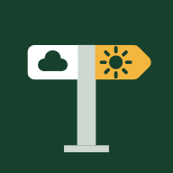

# Trekast

**Plan the weather for your bike tour, day by day.**

👉 **Open the app: https://leonvolles.github.io/trekast/**

Trekast (formerly GPX Weather) is a free web app for multi-day bike tours. You load the GPX file of
your route, choose how many kilometres you want to ride per day, and the app
splits the route into daily stages. For every stage you see what the weather
will be like on the road – at the time you will actually be there – plus
distance, climbing and how much head- or tailwind to expect.

The forecast comes from several weather models at once (ECMWF, ICON, GFS,
Météo-France). The app shows whether they agree, so you know how reliable the
forecast is.

No account, no sign-up, no ads. Your tours stay on your phone.



## What you get for every stage

- 📏 Distance, climb and descent, an elevation profile and the riding time
- 🌡️ Temperature while riding, how cold it feels, and the night low at the
  destination (useful when camping)
- 🌧️ Rain amount and rain probability while you ride
- 🌬️ Wind speed and direction, gusts, and **head- or tailwind in your direction
  of travel**
- 🌅 Sunrise and sunset, with a warning if you would arrive after dark
- ✅ Whether the weather models agree or disagree
- ⬇️ The GPX of just that stage, to load into your navigation app
- ⛺ Campsites along the last part of the stage, close to the route, listed and marked on the map

You also get a map of the whole tour (bike map by CyclOSM), an elevation profile,
an overview table of all stages, and the whole forecast as a PDF.

## Coming from GPX Weather?

The app used to be called GPX Weather and lived at
https://leonvolles.github.io/GPXweather/. That address still works. In a
browser tab your tours show up in Trekast right away. If you added
GPX Weather to your home screen, its tours are kept separately: open it, tap
**⚙️ Settings → 💾 Backup**, then add Trekast to your home screen and load the
file with **📥 Restore**.

## Install it on your iPhone

1. Open **https://leonvolles.github.io/trekast/** in **Safari**.
2. Tap the **Share** button (the square with the arrow).
3. Choose **Add to Home Screen**, then **Add**.

"Trekast" now sits on your home screen like a normal app. It opens full
screen and also starts without a connection, showing the last weather it
loaded.

> Always use the app from the home screen. The home-screen app and a Safari tab
> keep their tours separately.

**On Android:** open the link in Chrome, tap the **⋮** menu → **Add to Home
screen** (or **Install app**).

**On a computer:** just open the link in any browser.

## How to use it

### 1. Load or plan your tour

**Plan it right in the app:** tap **🧭** to open the route planner. Tap the map
for start, via points and destination – the route is calculated by
[BRouter](https://brouter.de/brouter-web/) on OpenStreetMap data. Choose a
profile (trekking bike, fast bike, safety first, shortest) and – for trekking –
options like 🚗 avoid main roads, 🚲 cycle routes only, ⛴️ no ferries or 🤫 quiet
roads. Drag points to adjust, then tap **✓ Use as tour**. **📲 GPX** saves the
route (e.g. for Bergfex Touren), **🌐 BRouter-Web** opens the same points and
profile in BRouter's full planner – export the GPX there and load it with 📂.
(BRouter-Web can't take your speed or weight from a link; Trekast's own
riding-time model is used for all times anyway.) Routes planned with BRouter bring their
road surfaces along, so the riding-time model knows them right away.

**Or load a GPX file:** get the GPX of your route, for example from Komoot,
Strava, Ride with GPS, Garmin or a tour website. On the iPhone, save it to the **Files** app first
(*Share → Save to Files*).

In Trekast tap **＋ GPX** and pick the file. The route, map and stages
appear right away; the weather follows a few seconds later. The tour is saved
on your phone, so you only do this once.

### 2. Set up your days

Open **Settings** and choose:

- **Plan each day by** **riding time** (default) or a **fixed distance**. With
  riding time you set the **hours on the road per day** (incl. breaks); each day
  ends where that time is up, worked out from your speed, the climbs, the road
  surface and the forecast wind – hilly, gravel or headwind days get shorter,
  easy days longer
- **Your speed on flat asphalt** (no wind) and your **breaks** in %. Once you
  upload recorded rides, the app measures both from them and plans with those
  (tick box underneath; typing a speed or breaks yourself switches back to
  your values)
- **Next stage** – **Today**, **Tomorrow**, **In 2 days** … (today by default);
  pick a later day if you start or continue the tour after a break
- **Daily departure** – when you usually set off
- **Weight** with bike and luggage (under More settings) – used by the
  riding-time estimate (see *How riding times are estimated*)
- **Weather models** – which forecasts to compare

### 3. Update your position on the way

Tap **📍 Update my position** and allow location access. The app finds where
you are on the route and plans only the part still ahead of you. After the
first time, your position is updated automatically whenever you open the app
(you can switch this off in Settings).

You can also tap the route on the map, or move the position slider.

The app keeps a small ride log: the days you have already ridden move into a
collapsed **✓ Completed** list (with date, km, climb and a GPX of each day),
followed by **today** and the stages still to come. Today's stage is planned
from where you set off in the morning, so updating your position during the
ride shows your progress ("40 km ridden · 40 km to go") instead of moving
today's goal.

A day only counts as ridden when you ended it, uploaded its ride or the GPS
saw you riding. If you just move the slider – for example to catch up with a
tour you started without the app – that part shows as **not logged** in the
Completed list and doesn't change your pace. Big position changes can be
undone with **↶ Undo** right after.

If you declined location access by mistake: iPhone **Settings → Privacy &
Security → Location Services → Safari Websites → While Using the App**.

### At the end of the day

You have two ways to close a day:

- **🏁 End today here** (on today's card) saves your current position as the
  end of today. The plan then continues tomorrow from there. Tapped too early? **Undo** reopens the day.
- **📤 Upload today's ride (GPX or FIT)** – load the track you recorded with your
  bike computer, watch or phone app (Garmin, Wahoo, Komoot, Strava …). The app
  finds where the ride lies on your route, ends that day there and puts what
  you **really** rode into the **✓ Completed** list (marked 📍): the recorded
  km and climb – shortcuts and detours included – time on the road and
  average speed. The tour total ("Ridden 312 of 1,480 km · planned 1,465") is
  what you rode plus the planned rest, and the map shows your recorded track
  instead of the planned line for that part. Rode with two files on one day
  (morning and afternoon)? Upload both – they are added up; uploading the same
  file again replaces it. **⬇ GPX** in the Completed list gives you the track
  as you rode it. You can also add earlier days later with **📤 Add a ridden
  day** in the Completed list – the date is taken from the GPX. FIT files
  straight from a Garmin, Wahoo or Hammerhead work as well (with heart rate,
  power, cadence and temperature), and you can pick several files at once.

  *Sharing straight from another app (e.g. Bergfex) into Trekast isn't
  possible on iPhone: iOS doesn't let web apps appear in the share sheet. The
  quickest way: in the other app **Share → Save to Files** into one folder,
  then **📤 Upload** in Trekast – the file picker opens on that folder.*

**📈 on a recorded day** opens what your bike computer or watch recorded:
moving time, average and top speed, heart rate (average and max), power
(average, normalized and max), cadence and the work in kJ (≈ kcal), a map of
the ride and a chart in the style of gpx.studio: the elevation profile
coloured by gradient (blue downhill, grey flat, yellow to dark red uphill),
and below it speed, heart rate, power, cadence and temperature on the same km
axis. Each of them can be switched on and off with the buttons above the
chart (your choice is remembered). Move your finger or mouse along the chart
to see every value at that point, and where that is on the map. Planned days
get the same elevation and gradient chart under **More about this day**. Heart rate, power and
cadence need a sensor and a GPX export that keeps them (Garmin, Wahoo,
Strava … do). Rides uploaded with an older version: upload the GPX again –
it replaces the old one.

### Changed your route?

Open **🗺️ Whole tour** and tap **🔁 Replace the route**, then pick the new
GPX. The tour stays the same – its name, settings, ridden days and uploaded
rides – and every day is placed on the new route again (uploaded rides by
their recorded track). If the new GPX starts where you are now (you planned
on from here), the part you have already ridden stays in front of it and
the new route continues from your position. **↶ Undo** brings the old route
back.

### Back to the route in the morning

Spent the night off the route (campsite, hotel)? The next day's plan starts
where you are – your last GPS position, or else the end of the ride you
uploaded – as soon as that is more than 200 m from the route. BRouter plans
the way back, and not simply to the nearest point: it tries several points
ahead of you on the route and takes the one that gets you on fastest, with
your own speed on climbs and surfaces. A steep climb up to the nearest point
loses against a slightly longer way that already goes in your direction.

The way back counts towards the day (km, riding time, weather) and is part of
the day's **📤 Share GPX**, so your navigation app leads you from the campsite
onto the route. It is dashed on the maps; today's card says how long it is and
where you join the route. Once you are riding, a stop next to the route
doesn't trigger it.

### Your pace

From uploaded rides the app measures how fast you really ride (as a speed on
flat asphalt without wind) and how long your breaks are, and plans the coming
days with that – as long as **Use speed and breaks measured from my uploaded
rides** is ticked. Without uploaded rides it uses the speed and breaks you
entered. In fixed-distance mode you can also plan with your average km/day
from completed days (opt-in). A day that shouldn't count can be removed with
**✕** in the Completed list.

### How riding times are estimated

The app does not just divide the distance by an average speed. It works out
your speed for every few hundred metres of the route, the way a cycling power
model does:

- **Climbs and descents** from the elevation profile – uphill you get slower
  depending on the gradient and your weight; downhill speed is limited (lower
  on steep descents).
- **Road surface** from OpenStreetMap – asphalt, cobbles, compacted gravel,
  gravel and dirt each have their own rolling resistance and safe top speed.
  The surface share is shown for every stage. It is loaded for the stages ahead
  in the background; until then the road counts as paved.
- **Wind** – the forecast head- or tailwind at the time you pass each part of
  the route. Headwind costs more time than the same tailwind saves.
- **Breaks** are added on top of the riding time.

Every stage shows the result, e.g. *"3:10 h on flat asphalt · climbs +25 min ·
surface +12 min · wind +18 min · breaks +55 min"*.

The model starts from your **speed on flat asphalt** and **breaks** in Settings.
As soon as you upload recorded rides, it calibrates itself: it finds the effort
that reproduces your moving time on exactly those roads, and your real share of
breaks – so a slow day in the hills is not mistaken for being slow in general.

### 4. Read the forecast

The page runs in the order of your tour – only today is open, everything else
opens with a tap:

1. **Tour overview** – how much you have ridden (dark green), today's stage
   (light green), what is left, days to go and the expected arrival.
   **🗺️ Whole tour** folds out the map of the whole route, the elevation
   profile, the route details and the PDF.
2. **✓ Completed** – the days behind you, one line each like the coming days
   (km, time, the weather you had, head- or tailwind). **Tap a day** and it
   opens in the same layout as the coming days: distance and climb as you
   rode it, time on the road, the weather and wind **where and when you were
   riding** (hour by hour, looked up afterwards from the weather model), the
   night at the day's end, your ride data with the elevation/gradient chart,
   the map of your ride and **📤 Share GPX**. Days without a recording use the
   planned route and estimated times. This is also where you **📤 upload** a
   ride you recorded.
3. **Today** (green box) – 📏 distance, ⏱️ time on the road (🚴 riding +
   ☕ breaks), weather with ☁️ cloud cover and 💨 wind, **👕 what to wear**,
   an **hour-by-hour** strip (where you will be and the weather there),
   **💡 rain advice** when rain is expected, and warnings. Buttons:
   **📤 Share GPX** (shows what's in the day's GPX, like tapping a GPX file in
   a chat, then **Share** it – to a chat, Bergfex Touren, your navigation app
   or Files – or **Copy** the GPX text), **⛺ Campsites** and **🏁 End day**.
   The header shows 🌅 sunrise and 🌇 sunset at the day's destination. **More about this day** has surface, elevation, the time
   estimate, day and night weather, **📤 Upload today's ride** and **😴 Rest
   day**. **🌦️ Weather models compared** shows what every model expects, with
   hourly charts.
4. **Today's route** on the map; switch to **Whole tour** any time. Optional
   overlays: **🌧️ Radar** (live rain radar with a time slider and a 🚴 where
   you will be) and **🛒 Supplies** (water, shops, bakeries, bike repair,
   toilets along today's route).
5. **📅 Coming days** – one line per day: distance, time on the road and the
   weather (temperature, rain, head- ↓ or tailwind ↑), 🌅 sunrise and 🌇 sunset,
   and a 📤 GPX button. Tap a day to open it in
   place: the same card as today plus a map of that day's route.

### Rest days

Not riding today? Open **More about this day** and tap **😴 Rest day** – the
plan simply continues tomorrow.

### 5. Find a campsite for the night

At the end of each stage, open **⛺ Campsites along the end of this stage**.
The app looks for campsites along your route, so you don't ride far out of your
way. Two settings decide where:

- **Last … km** – how much of the end of the stage is searched (0 = only around
  the stage end, up to 30 km). A campsite a few km before the end just makes
  the day a little shorter.
- **up to … km off the route** – how far a campsite may be from the route
  (0.5 to 10 km); that's your detour.

The list starts with the campsites closest to the stage end and shows for each
how far before the end it lies, how far off the route, and – if known –
website, phone and opening hours. The searched stretch is highlighted on the
map. They are also marked ⛺ on the map. **Directions** opens your maps app.

The campsites come from OpenStreetMap, so small or new places may be missing.
Check opening times before you go – many campsites close for the winter.

### 6. Take the forecast with you as a PDF

At the end of the page, tap **📄 Download the whole forecast as PDF**. The PDF
contains the overview of all stages, the elevation profile, the model
comparison and every stage in detail, including the campsites you searched
for. On the iPhone you can save it to Files or send it on.

### Several tours

Every GPX you load is kept. Switch between tours in the list at the top; 🗑
removes the selected tour from your phone.

## Backup

**⚙️ Settings → 💾 Backup** saves all your tours, positions, ride logs and
settings to one file (on the iPhone: *Save to Files*, e.g. iCloud Drive).
**📥 Restore** loads it again – on the same or a new phone.

## Good to know

- **Forecast range:** weather forecasts reach about 16 days ahead (some models
  less). Stages further away show the route and distances, and get weather as
  the date comes closer.
- **Why the models differ:** each weather service calculates the forecast
  differently. If they disagree a lot, the weather is hard to predict – check
  again closer to the day.
- **Gaps in the GPX:** some route files leave out parts, such as a ferry
  crossing. These are drawn as dashed lines and counted as a straight line.
- **Offline:** without a connection the app still opens with your tours and
  the last weather. The map background needs a connection; the route itself is
  always shown.
- **Your data:** your GPX files and tours are stored only on your device and
  are not uploaded anywhere. To get the weather, the app sends only the
  coordinates of points along your route to the weather service.
- **Unused for weeks?** Safari may clear data of websites that were not opened
  for a long time. Tours in the home-screen app are kept.
- This is not an official weather warning service. Always check local warnings
  before heading into the mountains or bad weather.

## Credits

Weather data by [Open-Meteo.com](https://open-meteo.com/) (CC BY 4.0), based on
models from ECMWF, DWD, NOAA, Météo-France and the UK Met Office. Elevation
data: Copernicus DEM via Open-Meteo. Routing: BRouter. Place names: BigDataCloud. Campsites and
supplies: OpenStreetMap via the Overpass API. Rain radar: RainViewer. Map:
[CyclOSM](https://www.cyclosm.org/), map data © OpenStreetMap contributors.

## Updates

The app checks for a newer version whenever you open it or bring it back to
the foreground, and shows **🔄 A new version is available – tap to update**.
The version you run is shown at the bottom of the page.

## Tests

`tests/` has a browser test that runs the app in Chromium with all outside
services mocked (weather, place names, OpenStreetMap, map tiles):

```
cd tests && npm install && npm test
```
